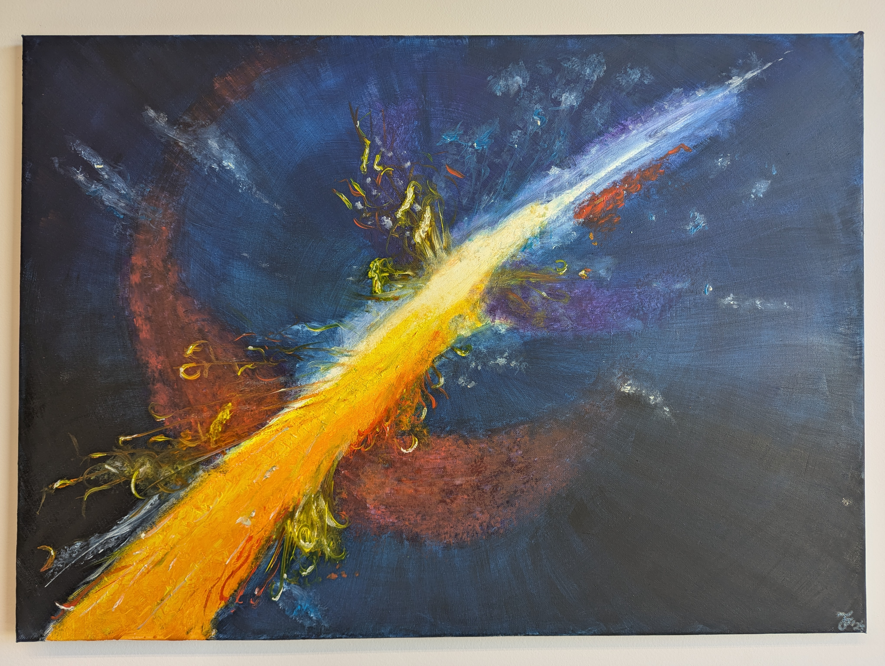
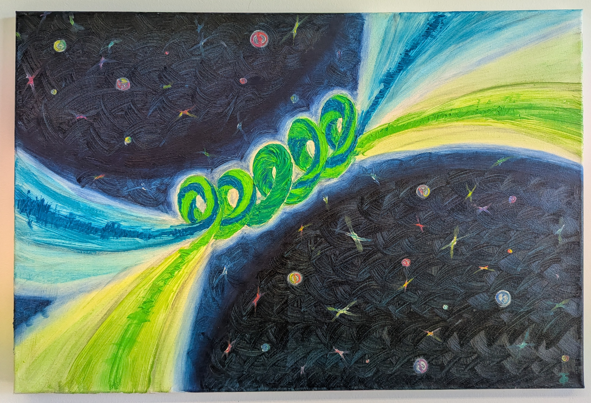
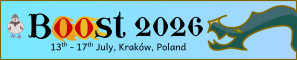
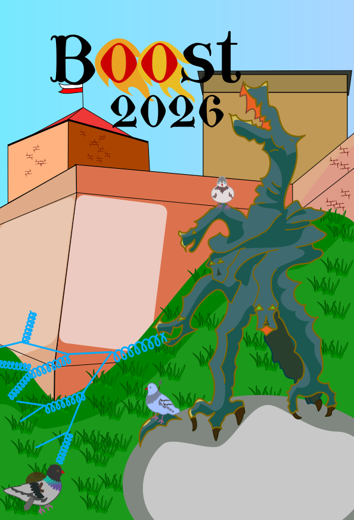
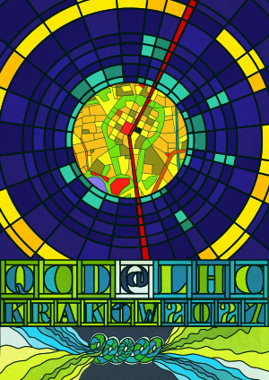
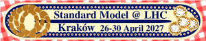
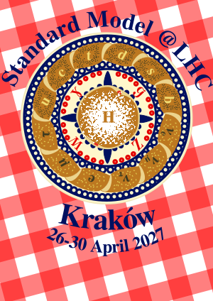

<h2>Popularisation articles</h2>

<h6> <b>Better understanding of the unknown leads to more accurate collision simulations</b> </h6>

2026 March, Eurekalert, <a href="https://www.eurekalert.org/news-releases/1118856">link</a>

<h6> <b>The Higgs does not seem to contain any factors from new physics</b> </h6>

2024 July, Eurekalert, <a href="https://www.eurekalert.org/news-releases/1051057">link</a>

<h2>Art & Conference Posters by Judith Fronczek-Poncelet</h2>

Intrigued by the idea of visualising the abstract topic of particle physics artistically, Judith started creating paintings inspired by Rene’s work on theoretical particle physics.
She also created several of the Posters used for conferences in Cracow.

<h6> <b>QCD</b> </h6>

2024, Oil on canvas, inspired by graphical art, Judith Fronczek-Poncelet 

<h6> <b>Coupled</b> </h6>

2025, Oil on canvas, jet pair production, Judith Fronczek-Poncelet 

<h6> <b>Boost 2026</b> </h6>

2026, digital art, from own coloured pencil drawing of the Wawel dragon in front of Wawel castle, Judith Fronczek-Poncelet 

<h6> <b>QCD@LHC 2027</b> </h6>

2026, digital art, Cracow map and Transverse plot as stained glass, inspired broadly by Wyspianski stained glass arts around Cracow, Judith Fronczek-Poncelet 

<h6> <b>SM@LHC 2027 Work in Progress</b> </h6>

2026, digital art, the Standard model in typical Cracow treats, Judith Fronczek-Poncelet 

<h5> <b> About the artist </b> </h5>

Judith Fronczek-Poncelet is a hobby artist interested in motives of nature, both realistic and fantastical. Typically working with acrylic, chalk and coloured pencils, she recently started to use impressionistic oil paintings as a medium, and branched into digital art for conference posters.

